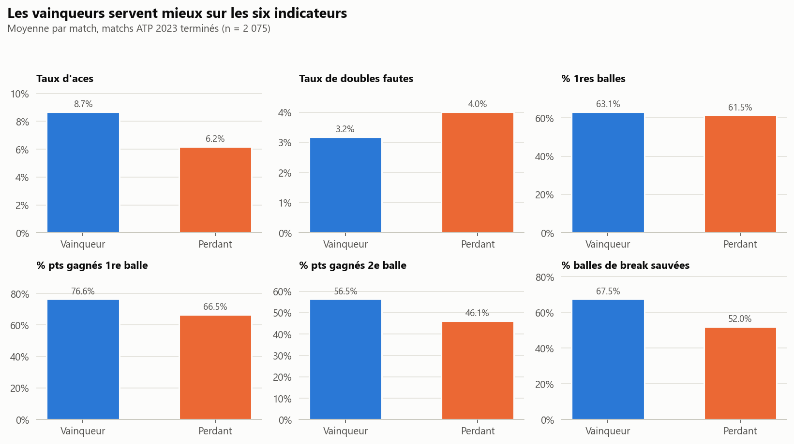
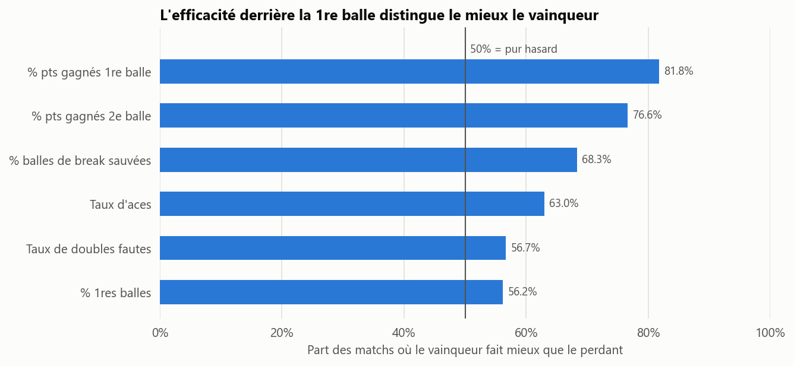
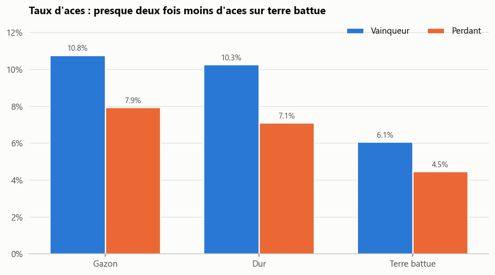
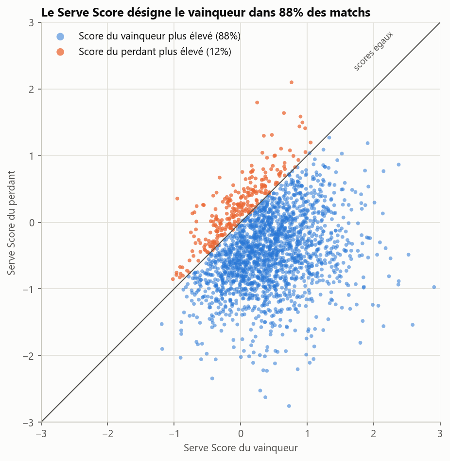
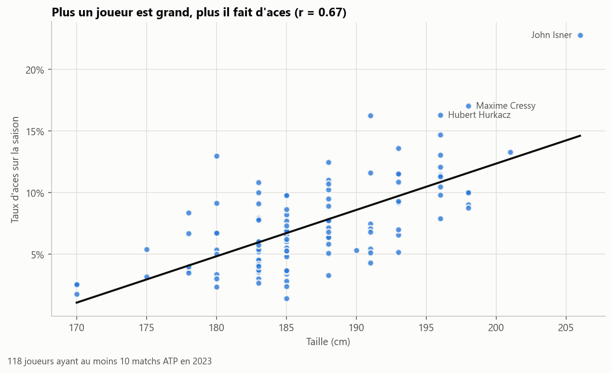

# 🎾 ATP Serve Impact Analysis

Analyse des **2 242 matchs ATP en simple de la saison 2023** pour mesurer le poids réel du service dans la victoire.

Au tennis, on dit souvent qu'un match « se gagne au service ». Ce projet vérifie cette idée avec les statistiques officielles des matchs : quels aspects du service séparent vraiment le vainqueur du perdant, et la réponse change-t-elle entre le gazon, le dur et la terre battue ?

## ❓ Question principale

> **Quels indicateurs de service différencient réellement les vainqueurs des perdants, et leur importance dépend-elle de la surface ?**

## 📊 Résultats clés

|  |  |
| --- | --- |
| **82 %** | des matchs : le vainqueur gagne plus de points sur sa 1re balle que le perdant. C'est l'indicateur le plus discriminant. |
| **56 %** | seulement pour le pourcentage de premières balles : presque du hasard. |
| **≈ 82 %** | sur chacune des trois surfaces : la surface ne change pas la hiérarchie des indicateurs. |
| **88 %** | des matchs : le joueur avec le meilleur *Serve Performance Score* gagne. |
| **r = 0,67** | entre la taille d'un joueur et son taux d'aces sur la saison. |

## 🗂️ Dataset

Données issues de **Kaggle**, qui reprend le dépôt open source [tennis_atp de Jeff Sackmann](https://github.com/JeffSackmann/tennis_atp) (licence CC BY-NC-SA 4.0).

| Fichier | Contenu | Utilisation |
| --- | --- | --- |
| `atp_matches_2023.csv` | 1 ligne par match : surface, classements, statistiques de service du vainqueur (`w_`) et du perdant (`l_`) | Toute l'analyse |
| `atp_players.csv` | Fiche des joueurs (taille, main, nationalité…) | Bonus taille / aces |

## 🛠️ Méthodologie

```text
Data Cleaning  →  Feature Engineering  →  Winner vs Loser  →  Surface Analysis  →  Upset Analysis  →  Serve Performance Score
```

1. **Nettoyage** : suppression des matchs sans statistiques de service (113, surtout en Coupe Davis) et des abandons ou forfaits (54). Le vainqueur d'un abandon n'a pas « gagné au service ». **2 075 matchs conservés** (Hard 921, Clay 832, Grass 322).
2. **Indicateurs** : des taux plutôt que des valeurs brutes, pour ne pas favoriser les matchs longs.

   | Indicateur | Calcul |
   | --- | --- |
   | Taux d'aces | aces / points au service |
   | Taux de doubles fautes | doubles fautes / points au service |
   | % de premières balles | 1res balles réussies / points au service |
   | % de points gagnés sur 1re balle | points gagnés / 1res balles réussies |
   | % de points gagnés sur 2e balle | points gagnés / 2es balles jouées |
   | % de balles de break sauvées | sauvées / concédées (vide si aucune concédée) |

3. **Vainqueurs contre perdants** : moyennes, et surtout la **part des matchs où le vainqueur fait mieux** que le perdant (50 % = l'indicateur ne distingue rien).
4. **Surface** : même comparaison sur gazon, dur et terre battue.
5. **Upsets** : matchs gagnés par le joueur le moins bien classé (`winner_rank > loser_rank`).
6. **Serve Performance Score** : indicateur personnel (non officiel) construit à partir de z-scores :
   `0,4 × 1re balle gagnée + 0,3 × 2e balle gagnée + 0,2 × aces − 0,1 × doubles fautes`.
7. **Bonus** : jointure avec `atp_players.csv` pour croiser la taille et le taux d'aces.

Outils : **Python, pandas, NumPy, Matplotlib**. Aucun modèle de machine learning : uniquement des statistiques descriptives.

## 📈 Principaux résultats

### 1. Les vainqueurs servent mieux sur les six indicateurs



Les écarts les plus nets portent sur l'**efficacité** : +10 points sur 1re balle, +10 points sur 2e balle, +15 points de balles de break sauvées. La **régularité** (pourcentage de premières balles) ne fait presque aucune différence : +1,6 point.

### 2. Ce qui compte, c'est de gagner le point derrière la 1re balle



Le vainqueur fait mieux sur la 1re balle dans **82 %** des matchs et sur la 2e dans **77 %**. Les aces (63 %) et les doubles fautes (57 %) comptent beaucoup moins qu'on pourrait le penser.

### 3. La surface change le niveau du service, pas son pouvoir de distinction



Il y a presque deux fois moins d'aces sur terre battue (5 %) que sur gazon ou sur dur (≈ 9 %). Pourtant l'écart vainqueur / perdant sur 1re balle reste d'environ **10 points sur les trois surfaces** : sur terre, on gagne sa 1re balle grâce au coup suivant plutôt que grâce à l'ace.

### 4. Le Serve Score désigne le vainqueur dans 88 % des matchs



Chaque point est un match. Sous la diagonale, le vainqueur avait le meilleur score. Le score est stable selon la surface (87–88 %), mais moins fiable lors des upsets (82 % contre 91 %).

### Bonus : les grands joueurs font plus d'aces



Sur 118 joueurs (≥ 10 matchs), 10 cm de plus correspondent à environ **+3,8 points de taux d'aces**. Les joueurs de plus de 1,95 m font 12 % d'aces, contre 5 % pour ceux de 1,80 m ou moins.

## ✅ Conclusion

- **Le service est très lié à la victoire** : le vainqueur gagne plus de points sur son service dans 91,5 % des matchs.
- **L'indicateur clé est le % de points gagnés sur 1re balle**, suivi de la 2e balle. Mettre beaucoup de premières balles ou faire des aces ne suffit pas : c'est la qualité du point derrière le service qui fait la différence.
- **Le gazon favorise le service** (plus d'aces, plus de jeux tenus), mais il ne le rend pas plus décisif : la hiérarchie des indicateurs est la même sur toutes les surfaces.
- **Les upsets ne s'expliquent qu'en partie par le service** : le moins bien classé ne sert pas mieux qu'un favori vainqueur, et l'écart au service se resserre (8 points sur 1re balle contre 11). La surprise se joue probablement davantage au retour et sur les points importants.
- Un **Serve Score simple** suffit à désigner le vainqueur dans 88 % des cas.

**Limites** : une seule saison et seulement le circuit principal. Les statistiques de service dépendent aussi du retour adverse : on mesure des associations, pas des causes.

## 🚀 Lancer le projet

```bash
git clone https://github.com/Dakarioo/ATP-Serve-Impact-Analysis.git
cd ATP-Serve-Impact-Analysis
pip install -r requirements.txt
jupyter lab notebooks/analyse_atp.ipynb
```

Le notebook lit les données dans `data/` et enregistre les graphiques dans `images/` (chemins relatifs depuis `notebooks/`).

## 📁 Structure

```text
ATP-Serve-Impact-Analysis/
├── data/
│   ├── atp_matches_2023.csv
│   └── atp_players.csv
├── notebooks/
│   └── analyse_atp.ipynb    # code, graphiques et interprétations
├── images/                  # graphiques exportés par le notebook
├── README.md
├── requirements.txt
└── .gitignore
```
